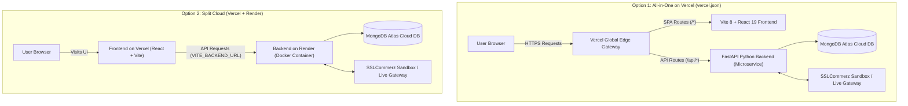

# 🚀 Deployment Guide: EZOPY MART TECH

This guide provides complete, step-by-step instructions for deploying **EZOPY MART TECH** to production. You can choose whichever setup suits your workflow best:

* **[Option 1: All-in-One Vercel Deployment (Frontend & Backend Both on Vercel)](#option-1-all-in-one-vercel-deployment-frontend--backend-both-on-vercel)** — *Recommended for simplicity: single domain, unified CI/CD, 0 CORS issues.*
* **[Option 2: Split Cloud Deployment (Frontend on Vercel + Backend on Render)](#option-2-split-cloud-deployment-frontend-on-vercel--backend-on-render)** — *Recommended for dedicated Docker container hosting on Render.*
* **[Option 3: Local Docker Compose (All-in-One Local Test)](#option-3-local-docker-compose-all-in-one-local-test)** — *1-command local development.*

---

## 🏗️ Architecture Options



---

## Option 1: All-in-One Vercel Deployment (Frontend & Backend Both on Vercel)

The repository includes a root **[`vercel.json`](file:///c:/Users/LENOVO/Desktop/E-Commerce/vercel.json)** configuration file that manages both the React frontend and FastAPI backend as microservices under a single Vercel project with unified routing.

### How It Works:
- **Frontend Service**: React 19 + TypeScript + Vite 8, builds to `dist/`, routes all SPA requests to `/index.html`.
- **Backend Service**: FastAPI Python 3.11+ application pointing to `main:app`.
- **Unified Routing**:
  - `/api/(.*)` rewrites directly to the FastAPI backend service.
  - `/(.*)` rewrites to the Vite frontend SPA.
- **Benefits**: Single domain (e.g. `https://ezopy-mart.vercel.app`), zero CORS configuration issues, unified Git deployments, and no monthly fees for separate container hosting.

### Step-by-Step Deployment:

#### Step 1: Push Repository to GitHub
Ensure your latest code is pushed to your GitHub repository:
```bash
git push origin master
```

#### Step 2: Import Project on Vercel
1. Log in to [vercel.com](https://vercel.com).
2. Click **Add New...** → **Project**.
3. Select and import your GitHub repository (`E-Commerce`).
4. **Project Settings**:
   - **Root Directory**: Leave as `./` (the root directory, so Vercel reads the root `vercel.json`).
   - Do **NOT** override the Build Command or Output Directory; Vercel will read them directly from `vercel.json`.

#### Step 3: Configure Environment Variables on Vercel
Under the **Environment Variables** section in Vercel, add the following keys:

| Key | Example Value | Description |
|---|---|---|
| `PROJECT_NAME` | `EZOPY MART TECH` | Project display name |
| `SECRET_KEY` | *(32+ character random string)* | JWT encryption key |
| `APP_BASE_URL` | `https://your-project.vercel.app` | Your live Vercel domain (no trailing slash) |
| `FRONTEND_URL` | `https://your-project.vercel.app` | Your live Vercel domain (no trailing slash) |
| `SSL_STORE_ID` | `samja695287` *(or your Store ID)* | SSLCommerz Store ID |
| `SSL_STORE_PASSWORD` | *(Your Store Password)* | SSLCommerz Store Password |
| `SSL_IS_LIVE` | `false` | `false` for Sandbox, `true` for Production |
| `MONGODB_DATABASE` | `mongodb+srv://...` | MongoDB Atlas SRV connection string |

*(Note: `VITE_BACKEND_URL` can be left empty in Option 1 because Vercel automatically routes `/api/*` to the FastAPI backend service).*

#### Step 4: Click Deploy
- Click **Deploy**.
- Vercel builds the frontend bundle and provisions the Python backend service.
- Once finished, test:
  - **Frontend UI**: `https://your-project.vercel.app`
  - **Interactive Swagger API Docs**: `https://your-project.vercel.app/api/docs`

---

## Option 2: Split Cloud Deployment (Frontend on Vercel + Backend on Render)

In this architecture, your Python backend runs as a persistent Docker container on Render.com, while your React frontend runs as a static SPA on Vercel's global CDN.

### Step-by-Step Deployment:

### Part 2A: Deploy Backend to Render.com

#### 1. Create a New Web Service on Render
1. Log in to [dashboard.render.com](https://dashboard.render.com).
2. Click **New +** → **Web Service**.
3. Connect your GitHub repository.
4. Set the following settings:
   - **Name**: `ezopy-mart-tech-backend` (or your choice)
   - **Region**: Singapore or Frankfurt
   - **Root Directory**: `backend` *(Crucial: set to `backend` so Render builds from the backend folder)*
   - **Runtime**: **Docker** (Render will detect `backend/Dockerfile`)
   - **Instance Type**: **Free** or **Starter**

#### 2. Configure Environment Variables on Render
Under **Environment Variables**, add:

| Key | Value | Description |
|---|---|---|
| `PORT` | `8000` | Port for Uvicorn (Render dynamically binds this) |
| `PROJECT_NAME` | `EZOPY MART TECH` | Application name |
| `SECRET_KEY` | *(32+ character random string)* | JWT encryption key |
| `APP_BASE_URL` | `https://ezopy-mart-tech-backend.onrender.com` | Your Render public backend URL (no trailing slash) |
| `FRONTEND_URL` | `https://your-project.vercel.app` | Your Vercel frontend URL (no trailing slash) |
| `SSL_STORE_ID` | *(Your Store ID)* | SSLCommerz Store ID |
| `SSL_STORE_PASSWORD` | *(Your Store Password)* | SSLCommerz Store Password |
| `SSL_IS_LIVE` | `false` | `false` for Sandbox, `true` for Live |
| `MONGODB_DATABASE` | `mongodb+srv://...` | MongoDB Atlas SRV connection string |

#### 3. Deploy Backend
- Click **Create Web Service**.
- Wait for Render to build the Docker image and deploy.
- Verify by visiting: `https://<your-backend>.onrender.com/docs` to see the interactive Swagger API documentation.

---

### Part 2B: Deploy Frontend to Vercel.com

#### 1. Import Project on Vercel
1. Log in to [vercel.com](https://vercel.com).
2. Click **Add New...** → **Project**.
3. Import your GitHub repository.
4. **Project Settings**:
   - **Root Directory**: Click **Edit** and choose `frontend`.
   - **Framework Preset**: **Vite** (auto-detected).
   - **Build Command**: `npm run build`.
   - **Output Directory**: `dist`.

#### 2. Configure Environment Variables on Vercel
Under **Environment Variables**, add:

| Key | Value | Description |
|---|---|---|
| `VITE_BACKEND_URL` | `https://<your-backend>.onrender.com` | Your live Render backend URL (no trailing slash) |

#### 3. Deploy Frontend
- Click **Deploy**.
- The `frontend/vercel.json` file ensures that all client-side routes (SPA) rewrite to `/index.html`.

---

### Part 2C: Connect & Sync Both Services
1. Once your Vercel frontend is live, copy its domain (e.g., `https://ezopy-mart.vercel.app`).
2. Go to **Render Dashboard** → Your Web Service → **Environment Variables**:
   - Update `FRONTEND_URL` to your live Vercel URL.
   - Click **Save Changes** (Render will automatically redeploy).
3. Verify that `VITE_BACKEND_URL` on Vercel points to your live Render backend URL.

---

## Option 3: Local Docker Compose (All-in-One Local Test)

To test the entire full-stack application locally in isolated containers:

```bash
# 1. Clone the repository
git clone https://github.com/Shah-Abdul-Mazid/E-Commerce.git
cd E-Commerce

# 2. Build and run containers
docker compose up --build
```

- **Frontend Application**: [http://localhost:5174](http://localhost:5174)
- **Backend Swagger API Docs**: [http://localhost:8000/docs](http://localhost:8000/docs)
- **FastAPI Root**: [http://localhost:8000/](http://localhost:8000/)

---

## ✅ Post-Deployment Verification Checklist

Once deployed with either option, verify these key workflows:

1. **Product Browsing**:
   - Education courses (B.Sc. CSE curriculum) and AI packages load correctly.
2. **Pre-Checkout Auth Gating**:
   - Clicking **Buy Now** when logged out prompts you to Sign In or Register.
   - Upon login, checkout modal opens automatically for the selected item.
3. **Database Profile Auto-Fill**:
   - Customer Name, Email, and Phone number automatically populate and lock in the checkout modal.
4. **SSLCommerz Payment Callback**:
   - Completing a sandbox test payment redirects back to your dashboard with real-time verification and auto-refreshing subscriptions without requiring a manual browser reload.
5. **Customer Support & Footer**:
   - Contact numbers (`01531329222`, `01560024587`), WhatsApp button (`+8801531329222`), and email links operate cleanly.

---

## 📄 License & Credits
- **Brand**: EZOPY MART TECH
- **Curated & Developed by**: Shah Abdul Mazid
- **Dedicated with warmth to**: Jannat Farhana Popy
- All rights reserved.
