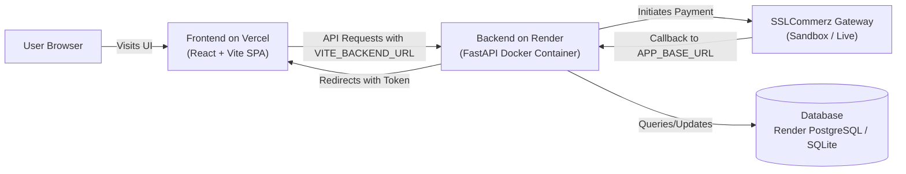

# 🚀 Deployment Guide: SAMJAP Mart

This guide details how to deploy **SAMJAP Mart** to production:
- **Backend (FastAPI + SSLCommerz + Uvicorn)** on [Render.com](https://render.com) using **Docker**
- **Frontend (React 19 + TypeScript + Vite + Tailwind CSS)** on [Vercel](https://vercel.com) with **`vercel.json`**

---

## 🏗️ Architecture Overview



---

## Part 1: Deploy Backend to Render (render.com)

Render builds and runs your container using the `backend/Dockerfile`.

### Step 1: Create a New Web Service on Render
1. Log in to [dashboard.render.com](https://dashboard.render.com).
2. Click **New +** → **Web Service**.
3. Connect your GitHub/GitLab repository containing this project.
4. Set the following settings:
   - **Name**: `samjap-mart-backend` (or your preferred name)
   - **Region**: Choose closest (e.g., *Singapore* or *Frankfurt*)
   - **Root Directory**: `backend` *(Important: set this so Render builds from inside the backend folder)*
   - **Runtime**: **Docker** (Render will automatically detect `backend/Dockerfile`)
   - **Instance Type**: **Free** or **Starter**

### Step 2: Configure Environment Variables on Render
Under **Environment Variables**, add the following:

| Key | Value | Description |
|---|---|---|
| `PORT` | `8000` | Port for Uvicorn (Render sets this dynamically, Dockerfile supports `${PORT:-8000}`) |
| `PROJECT_NAME` | `SAMJAP Mart` | Application name |
| `SECRET_KEY` | *(Generate a 32+ char random string)* | JWT encryption key |
| `APP_BASE_URL` | `https://samjap-mart-backend.onrender.com` | Your Render public backend URL (no trailing slash) |
| `FRONTEND_URL` | `https://samjap-mart.vercel.app` | Your Vercel frontend URL (no trailing slash) |
| `SSL_STORE_ID` | `jfpet6acc0a12e3919` | SSLCommerz Store ID (sandbox or live) |
| `SSL_STORE_PASSWORD` | `jfpet6acc0a12e3919@ssl` | SSLCommerz Store Password |
| `SSL_IS_LIVE` | `false` | `false` for Sandbox, `true` for Live |
| `DATABASE_URL` | `sqlite+aiosqlite:///./samjap_mart.db` | Or attach a Render PostgreSQL database |

> [!TIP]
> **Persistent Database on Render**:
> Render's free tier uses ephemeral storage. For production persistence, create a **Render PostgreSQL** database (New + → PostgreSQL), copy the internal Database URL, and set it as `DATABASE_URL`. The backend automatically converts standard `postgres://` or `postgresql://` connection strings to `postgresql+asyncpg://` for async SQLAlchemy.

### Step 3: Deploy
- Click **Create Web Service**.
- Wait for Render to build the Docker image and start the container.
- Test your backend by visiting: `https://<your-backend-slug>.onrender.com/docs` to see the interactive Swagger API documentation.

---

## Part 2: Deploy Frontend to Vercel (vercel.com)

Vercel is the optimal host for React/Vite single-page applications. It builds the static assets and distributes them across its global Edge CDN.

### Step 1: Import Project into Vercel
1. Log in to [vercel.com](https://vercel.com).
2. Click **Add New...** → **Project**.
3. Import your GitHub repository.
4. In the configuration screen:
   - **Root Directory**: Click **Edit** and select `frontend`
   - **Framework Preset**: **Vite** (auto-detected)
   - **Build Command**: `npm run build`
   - **Output Directory**: `dist`

### Step 2: Set Environment Variables on Vercel
Before clicking Deploy, expand **Environment Variables** and add:

| Key | Value | Description |
|---|---|---|
| `VITE_BACKEND_URL` | `https://samjap-mart-backend.onrender.com` | Your live Render backend URL (no trailing slash) |

### Step 3: Deploy
- Click **Deploy**.
- Vercel will install dependencies, execute `npm run build`, and deploy your SPA in seconds.
- The included `frontend/vercel.json` ensures that client-side routing rewrites all paths back to `/index.html` seamlessly.

---

## Part 3: Connect Frontend & Backend

Once both are deployed:
1. Update `FRONTEND_URL` on Render with your actual Vercel domain (e.g. `https://samjap-mart.vercel.app`).
2. Update `VITE_BACKEND_URL` on Vercel if your Render domain changed, then trigger a redeploy on Vercel (env vars are bundled at Vite build time).
3. Test the flow:
   - Browse CSE courses & AI tools
   - Test language switcher (Bangla, English, Hindi, German, Finnish, etc.)
   - Test checkout with SSLCommerz Sandbox (redirects to SSLCommerz and returns to Vercel dashboard with transaction receipt)

---

## Part 4: Local Docker Run (Optional)

To test the entire stack with Docker locally on your machine:

```bash
# Build and run both backend and frontend together
docker compose up --build

# Open in browser:
# Frontend: http://localhost:5174
# Backend:  http://localhost:8000/docs
```
